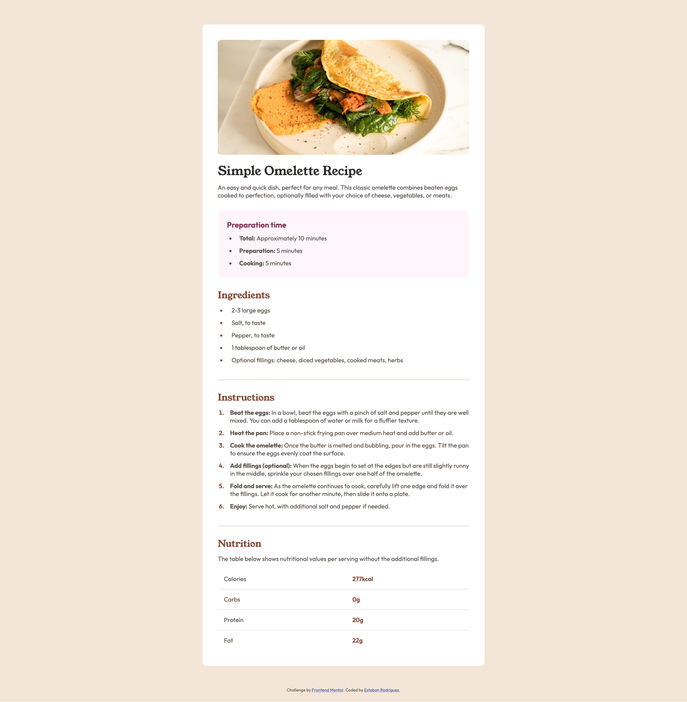

# Frontend Mentor - Recipe page solution

This is a solution to the [Recipe page challenge on Frontend Mentor](https://www.frontendmentor.io/challenges/recipe-page-KiTsR8QQKm). Frontend Mentor challenges help you improve your coding skills by building realistic projects.

## Table of contents

- [Overview](#overview)
  - [The challenge](#the-challenge)
  - [Screenshot](#screenshot)
  - [Links](#links)
- [My process](#my-process)
  - [Built with](#built-with)
  - [What I learned](#what-i-learned)
  - [Continued development](#continued-development)
  - [Useful resources](#useful-resources)
  - [AI Collaboration](#ai-collaboration)
- [Author](#author)

## Overview

### Screenshot



### Links

- Live Site URL: [Live Site](https://estebanrodriguez28.github.io/recipe-page/)

## My process

Started by first analyzing the designs and seeing how to structure the html. I knew the different parts (Ingreidents, Instructions, Nutrition) could be split with sections tags. I saw that each section's heading had the same style (red with the Young Serif font). I noticed that each section lists followed similar formats (especially prepartion time and instructions) starting with list tag and then list items with a strong tag to emphasize the first word.

Using emmet I was able to first structure the html reasonably quickly for example for the lists this shortcut allowed me to quickly create the structure:

```html
<!-- ul>li*3>strong -->
```

While creating the structure I also started creating classes for elements I believed would need one before writing css.

Then once html setup, I started with the css first the base styles (reset, fonts, centering on the page). Then started at the top of the page and worked down adding styles working section by section.

### Built with

- Semantic HTML5 markup
- CSS custom properties
- Flexbox

### What I learned

I learned I can break up the recipe page into sections and with the hr tag add a line separating them which also defines a shift in topic.

```html
<section class="recipe-ingredients">
  <h2 class="recipe-section-header">Ingredients</h2>
  <!-- Rest of section html -->
</section>
<hr />
<section class="recipe-instructions">
  <!-- Rest of section html -->
</section>
```

However I learned how to use tables in html, which was a more appropriate fit for the nutrition section as the hr tag represents a shift in topic. The ingredient's nutritional values align more with a table which groups data with labels. The tr tag defines a new row, columns go within tr tags. The th tag defines the data header or label and td defines the data value. The scope on th says where the label applies (row or column in this case row).

```html
<table class="nutrition-table">
  <tr>
    <th scope="row">Calories</th>
    <td>277kcal</td>
  </tr>
  <tr>
    <th scope="row">Carbs</th>
    <td>0g</td>
  </tr>
  <tr>
    <th scope="row">Protein</th>
    <td>20g</td>
  </tr>
  <tr>
    <th scope="row">Fat</th>
    <td>22g</td>
  </tr>
</table>
```

By default list items have a padding to the left of 40px, when I reset padding for my css reset I have to add padding to the list items myself. I was confused why without my reset the list items seem to be in the right place like the design. Claude explained was because of my reset.

```css
* {
  margin: 0;
  padding: 0;
  box-sizing: border-box;
}
```

So I ended up keeping my padding reset and added my own padding as the normal padding was too much anyways and did not match the design as much.

```css
ul,
ol {
  padding-left: 1.25rem;
}
```

Back to the table I found a property called border-collapse which allowed me to add a border to the bottom of each row and use the last-child pseudo class to remove the border on the last row to match the design.

```css
.nutrition-table {
  border-collapse: collapse;
  width: 100%;
  text-align: left;
  tr {
    border-bottom: 1px solid var(--stone-150);

    &:last-child {
      border-bottom: none;
    }
  }
  th {
    font-weight: 400;
    padding: 1rem;
  }
  td {
    color: var(--brown-800);
    font-weight: 600;
    padding: 1rem;
  }
}
```

I had some padding for the card for both the mobile and desktop designs but the mobile design has padding for everything except the image. This was a bit tricky cause I had a class for article that added padding for the whole card including the image. Which worked fine for desktop but on mobile the image takes up the whole width.

To match the mobile design, without having to restructure my html, Claude gave me a solution with negative margins. On mobile there is still padding but not on the image. The fix was to, just for the image, set the width to 100% of the parent plus the padding on the left and right. That way the image stretches the whole width, growing on the sides with the padding added. Then using negative margins to position the image on the edges of the screen, where the image would have been without the padding.

```css
.recipe {
  display: flex;
  flex-direction: column;

  padding: var(--recipe-card-padding);
  gap: 1.75rem 0rem;

  img {
    width: calc(100% + var(--recipe-card-padding) * 2);
    border-radius: 0px;
    margin: var(--reverse-card-padding) var(--reverse-card-padding) 15px;
  }
}
```

Before I had p tags within my list items but Claude pointed out that list item's can already hold text so you dont need extra p tag. But I did not want to go manually in each li tag and remove the p tag. Vs code has a feature where you can search for something within your code. Within that feature you can toggle regex or regular expressions that can search for patterns.

This was useful in getting rid of the p tag's as I was able to use a regular expression:

```html
<!-- <li>\n\s*<p> -->
```

To find everywhere where I had an li tag followed by a p tag and could replace all instances with just an li tag. Then repeating this with the closing tags. This way I did not have to manually go through each one. This should come in handy in the future.

### Continued development

I would like to continue using emmet to write faster html and to think ahead and implement classes within html before writing my css to get into the habit of thinking first of reusability. I would also like to be more consistent with the values I use throughout my priject (rem instead of px) stick with one where it make sense. Also to use css variables more often for maintainability.

### Useful resources

- [Remove Borders on Last element](https://stackoverflow.com/questions/55480980/how-to-remove-border-from-elements-in-the-last-row) - This helped me in removing the border for the last row in the table with the last-child pseudo class.
- [Table styling](https://www.w3schools.com/cssref/pr_border-collapse.php) - This helped me get the table to look like the design with the border-collapse propety.

### AI Collaboration

I used Claude desktop to connect to my project and I mostly used it for debugging and brainstorming. I have some examples for how I used it in what I learned section. I used it on steps where I was stuck, at the end when I felt confident I asked for feedback and implemented its suggestions.

## Author

- Frontend Mentor - [@estebanrodriguez28](https://www.frontendmentor.io/profile/estebanrodriguez28)
